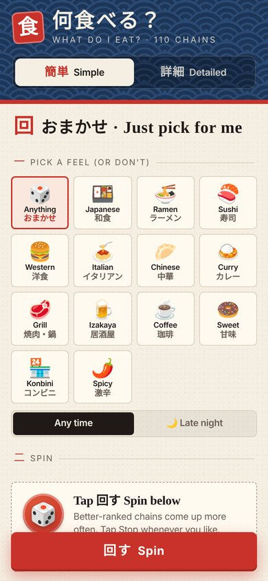
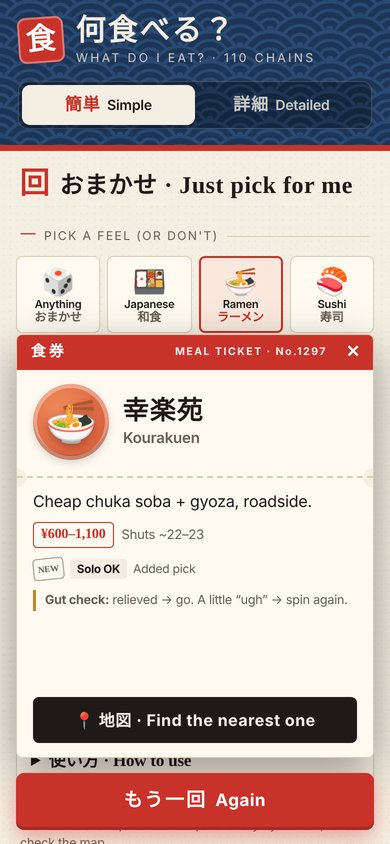
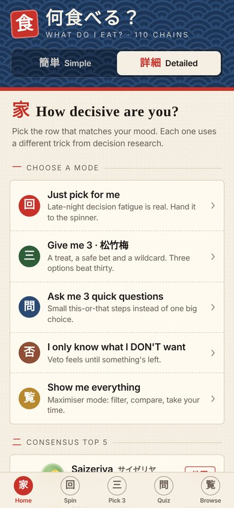
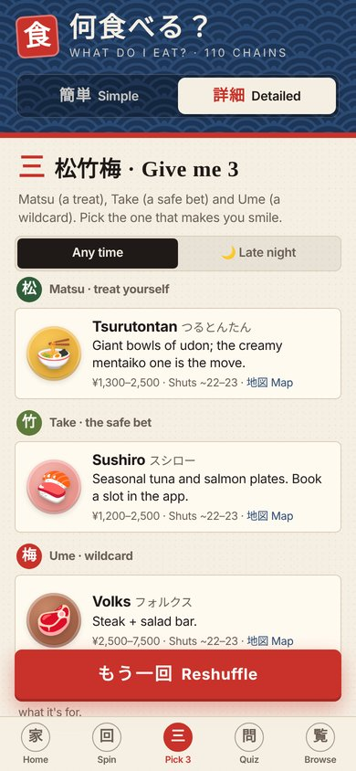
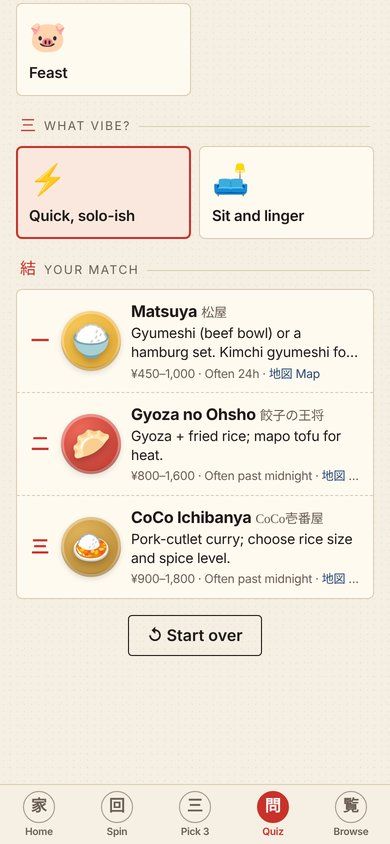
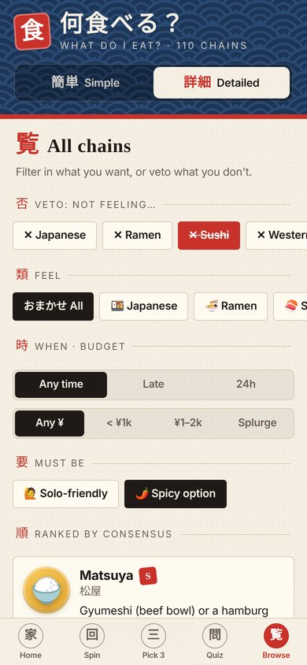
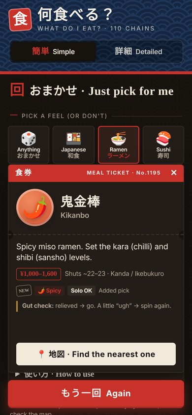

# 食 何食べる？
### What do I eat?

**Can't decide where to eat in Japan? Tap once and let it pick for you.**

110 Japanese food chains · ramen, sushi, gyudon, curry, coffee, konbini and more 
One file · works offline · no app, no sign-up, no coding

## [⬇️ Download it here (tap me)](https://github.com/Junteki/what-do-i-eat/archive/refs/heads/main.zip)

or **[🌐 open it in your browser, no download](https://junteki.github.io/what-do-i-eat/what-do-i-eat.html)**

 &nbsp; 

---

## 📲 How to get it on your iPhone (1 minute)

1. **Tap the [⬇️ Download](https://github.com/Junteki/what-do-i-eat/archive/refs/heads/main.zip) link above.** When Safari asks, tap **Download**.
2. **Open the Files app** (the blue folder icon) → tap **Browse** → **Downloads**.
3. **Tap `what-do-i-eat-main.zip`.** It unzips into a folder with the same name.
4. **Open that folder and tap `what-do-i-eat.html`.** The app opens right there. 🎉
5. *(Optional)* Long-press the file → **Move** → put it somewhere easy like **On My iPhone**, so it's one tap away next time.

> 💡 You only need the one file, **`what-do-i-eat.html`**. The other folders in the download are screenshots and developer files you can ignore or delete.

**Android:** download, open the ZIP in your Files app, then tap `what-do-i-eat.html` and open it with Chrome.
**Computer:** download, unzip, then double-click `what-do-i-eat.html`.

---

## 🍱 How to use it

At the top there's a switch: **簡単 Simple** or **詳細 Detailed**. Change it any time.

### 簡単 Simple: for when you just want an answer
1. Tap a **feel** (Ramen, Sushi, Coffee, Spicy…) or leave it on **おまかせ Anything**.
2. After midnight? Tap **🌙 Late night** so it only shows places that are likely still open.
3. Tap **回す Spin**. You get a **食券 meal ticket** with the place, what to order and the price.
4. Tap **📍 地図** to open Google Maps and find the nearest one.
5. Not feeling it? Tap **もう一回 Again**, then **止める Stop**. Tap **✕** to change the feel.

> 🪙 **Gut check:** when the ticket lands, notice how you feel. Relieved? Go. A little "ugh"? Your gut wants something else, so spin again.

### 詳細 Detailed: pick a mode that matches your mood

  

| Tab | Use it when… | What happens |
|---|---|---|
| **回 Spin** | "Just pick for me" | Same spinner as Simple mode. |
| **三 Pick 3 (松竹梅)** | You're a bit unsure | You get three: **松 a treat**, **竹 a safe bet** and **梅 a wildcard**. Choose one. |
| **問 Quiz** | You're very indecisive | Answer 3 easy questions (rice or noodles? how hungry? quick or sit-down?) and get your top 3. |
| **覧 Browse** | You know what you DON'T want, or you want to see everything | Tap feels to **veto** them (they turn red), or filter by late-night, budget, solo-friendly or spicy. |

 

---

## ❓ Questions

**Is it free and safe?**
Yes. It's a single webpage file with no ads, tracking or sign-in, and it doesn't collect anything. The only time it goes online is when you tap 地図 Map.

**Do I need internet?**
No, except for the Map button.

**Nothing happens when I tap Spin.**
It needs **iOS 15.4 or newer** (or a recent Chrome, Edge or Firefox on Android or a computer). Update your phone and try again.

**Does it know what's open right now?**
No. "Often 24h" and "Shuts ~22–23" are typical hours, and every branch is different. Always check the map.

**What do S / A / B and NEW mean?**
S–D is how well each chain ranked across eight popular Instagram tier lists. **NEW** chains were added so you have more options, and they aren't ranked.

**Can I just use it in my browser?**
Yes: **[junteki.github.io/what-do-i-eat/what-do-i-eat.html](https://junteki.github.io/what-do-i-eat/what-do-i-eat.html)**. In Safari, tap Share → **Add to Home Screen** and it sits on your phone like an app.

**Can I share it?**
Yes. Send people this page's link, or AirDrop them the `what-do-i-eat.html` file.

---

📊 Where the rankings come from

The tiers combine eight Instagram tier lists: tier_japan_lab, tenten_in_japan (×2), tierskingdom, japanpicksbylocals, travelwiththevees, jpn_things and japanfoodtier. Each placement is scored S=5 … D=1 and averaged, with one neutral vote added so a chain ranked by only one list can't jump to the top. Better-ranked chains come up more often when you spin.

🛠 For developers

Everything is in `for-developers/`: chain data (`data.py`), the page template (`tpl_jp.html`) and the generator (`build_jp.py`). Rebuild with `python3 for-developers/build_jp.py what-do-i-eat.html`. The page uses no JavaScript: modes, tabs, filters and the spinner are pure CSS (`:has()`, radio inputs and a `steps()` animation reel), so it works inside the iOS Files preview.

